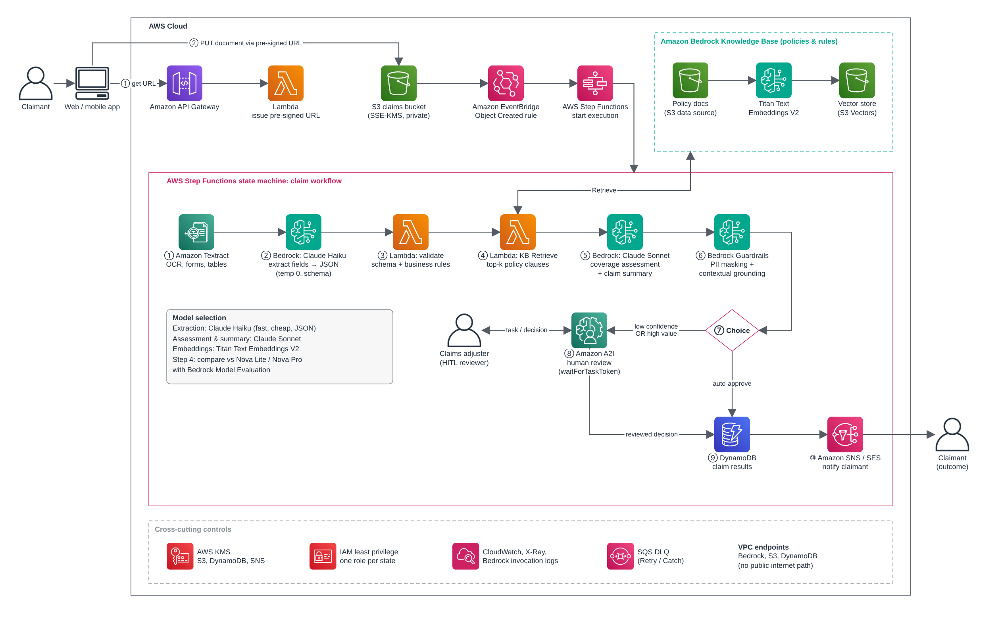

# Insurance Claim RAG System

Policy-grounded claims processing on Amazon Bedrock. A claim document goes in; out comes the extracted claim
data, a coverage assessment that cites the exact policy clauses it relies on, and a routing decision:
auto-approve or send to a human adjuster.

> **Status:** in development — proof of concept. Results and model comparison will be published in
> [`docs/FINDINGS.md`](docs/FINDINGS.md).

## Why it matters

Claims handlers spend much of their time reading documents and checking them against policy wording. This
project shows how generative AI can do the first pass safely: every coverage statement must be grounded in a
retrieved policy clause, outputs are validated before they are trusted, PII is masked, and low-confidence or
high-value claims always go to a person.

## Architecture



The proof of concept implements the core of this flow in Python, with a swap point wherever the production
service replaces a PoC piece:

| Stage | Proof of concept | Production path |
| :- | :- | :- |
| Read document | Bedrock Converse document block | Amazon Textract / Bedrock Data Automation |
| Extract fields | Claude Haiku → JSON, schema + business-rule validation | same, in a Step Functions state |
| Retrieve policy clauses | In-memory vector search, Titan Text Embeddings V2 | Bedrock Knowledge Bases (S3 Vectors) |
| Assess coverage + summarise | Claude Sonnet, citing clause IDs | same |
| Safety | Regex PII masking + grounding check | Bedrock Guardrails |
| Route | Confidence / claim-value rules | Step Functions Choice → Amazon A2I human review |

## Project layout

```text
src/claims_rag/components/   reusable: model invoker, prompt manager, validators, retriever, router
src/claims_rag/app/          claims logic: upload, pipeline steps, processor
prompts/  rules/             versioned prompt templates and business rules (YAML)
data/                        synthetic policies, claims and ground truth
eval/                        model comparison: accuracy, summary quality, latency, cost
terraform/                   S3 (SSE-KMS), KMS, least-privilege IAM
docs/                        HLD, LLD, findings, verification reports
```

## Development

```bash
python3.12 -m venv .venv && source .venv/bin/activate
pip install -r requirements-dev.txt
ruff format --check src tests && ruff check src tests && mypy src
pytest -m "not integration"
```
