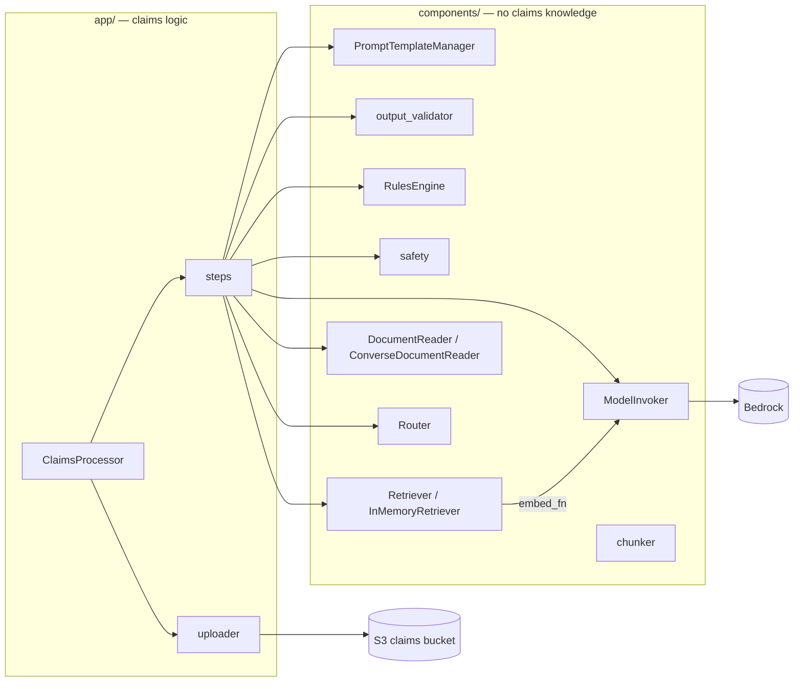
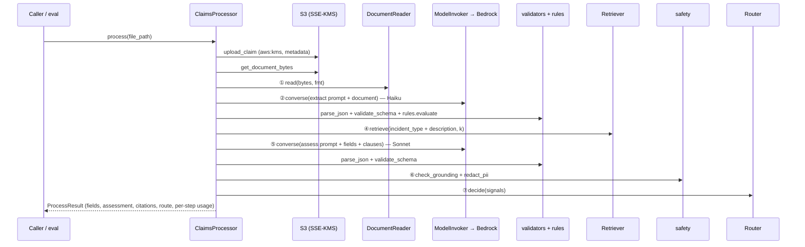

# **insurance-claim-rag-system Low Level Design**

## 1. **Document History**

| Version | Date | Author | Change |
| :- | :- | :- | :- |
| 1.0 | 2026-10-23 | Tebogo Tseka (with Claude) | First issue, from `PLAN_insurance-claim-rag-system.md` v1.2 |
| 1.1 | 2026-10-23 | Tebogo Tseka (with Claude) | **Approved.** TBC1, 5, 6, 7 accepted; TBC4 in scope: scanned-PDF fallback (`ScanAwareDocumentReader`, image blocks) |

## 2. **Introduction**

**Purpose.** Define every class, function, data contract, file format and AWS resource the proof of concept
(PoC) builds, so that code is written against this document and nothing else.

**Target architecture.** `docs/HLD/claims-processing-architecture.png`. The PoC implements stages ①–⑦ in one
Python process; ⑧–⑩ (A2I, DynamoDB, SNS/SES) are out of scope and the `route` field is the hand-off point.

**In scope.** Upload to S3 (SSE-KMS) · document read · field extraction · validation (schema + business rules) ·
policy retrieval (in-memory RAG) · coverage assessment + summary · grounding check + PII redaction · routing ·
model evaluation across four models · Terraform for storage and IAM · CI.

**Out of scope.** Web UI, API, human-review workflow, persistence of results, notifications, the optional
"extra challenge" items in the brief.

**Design rules.**

1. `components/` know nothing about claims; `app/` holds every claims concept.
2. Every dependency is passed in (constructor or argument); only the two factories (`build_processor`,
   `ModelInvoker.from_region`) create AWS clients.
3. Models, prompts, rules and thresholds change through config/YAML only — never through code.
4. Each pipeline step takes and returns JSON-serialisable data, so it can later become one Step Functions state.
5. Business failures (bad JSON, rule violations, ungrounded output) never crash the pipeline — they route the
   claim to human review with reasons. Technical failures (AWS errors after retries) raise.

## 3. **User Stories**

| # | As a… | I want… | Acceptance criteria |
| :- | :- | :- | :- |
| US1 | claims handler | the key fields extracted from a claim document in any of PDF, DOCX, TXT | Fields match §6.1; invalid or missing fields are listed, not guessed |
| US2 | claims handler | a coverage assessment that cites the policy clauses it relies on | Every cited `clause_id` exists in the retrieved clauses (§4.6); a decision without citations fails grounding |
| US3 | claims manager | risky claims sent to a person | Low confidence, high value, rule violations, failed grounding or insufficient information → `human_review` with reasons |
| US4 | compliance officer | personal data masked in outputs and logs | Emails, phone numbers and ID numbers never appear in the summary, the logs or the eval CSV |
| US5 | solution architect | to change the model, prompt or rules without touching code | Demonstrated in FINDINGS.md by swapping each via env var / YAML only |
| US6 | evaluator | models compared on accuracy, summary quality, speed and cost | `eval/run_eval.py` produces the CSVs in §7; FINDINGS.md interprets them |

## 4. **Components**



All public data types are frozen `dataclasses` with a `to_dict()` method. Errors derive from
`claims_rag.errors.ClaimsRagError` (§8).

### 4.1. `config.py` — `Settings`

```python
@dataclass(frozen=True)
class Settings:
    aws_region: str            # AWS_REGION            (required)
    claims_bucket: str         # CLAIMS_BUCKET         (required)
    claims_kms_key_id: str     # CLAIMS_KMS_KEY_ID     (required; alias ARN from terraform output)
    extract_model_id: str      # EXTRACT_MODEL_ID      default "us.anthropic.claude-haiku-5-5"
    assess_model_id: str       # ASSESS_MODEL_ID       default "us.anthropic.claude-sonnet-5-5"
    embed_model_id: str        # EMBED_MODEL_ID        default "amazon.titan-embed-text-v2:0"
    judge_model_id: str        # JUDGE_MODEL_ID        default "us.anthropic.claude-opus-5-5"
    prompts_dir: Path          # PROMPTS_DIR           default "prompts"
    rules_dir: Path            # RULES_DIR             default "rules"
    policies_dir: Path         # POLICIES_DIR          default "data/policies"
    top_k: int                 # TOP_K                 default 3
    chunk_size: int            # CHUNK_SIZE            default 800 (characters)
    chunk_overlap: int         # CHUNK_OVERLAP         default 100 (characters)
    max_retries: int           # MAX_RETRIES           default 5

    @classmethod
    def from_env(cls, env: Mapping[str, str] = os.environ) -> "Settings": ...
```

Missing required variable or a non-integer numeric → `ConfigError` naming the variable. A committed
`.env.example` lists every variable; `.env` is gitignored.

### 4.2. `components/model_invoker.py` — `ModelInvoker`

```python
@dataclass(frozen=True)
class DocumentInput:
    """What a model receives as the document: raw bytes for a Converse document block, or extracted text."""
    name: str
    format: str | None = None      # "pdf" | "docx" | "txt" when content is bytes
    content: bytes | None = None
    text: str | None = None        # set instead of content by a text-producing reader (e.g. Textract)
    images: tuple[bytes, ...] = () # PNG page images, set instead of content for scanned PDFs (§4.9)

@dataclass(frozen=True)
class ModelResponse:
    text: str
    input_tokens: int
    output_tokens: int
    latency_ms: int
    model_id: str
    stop_reason: str               # "end_turn" | "max_tokens" | ...

class ModelInvoker:
    def __init__(self, client: BedrockRuntimeClient) -> None: ...

    @classmethod
    def from_region(cls, region: str, max_retries: int = 5) -> "ModelInvoker":
        """bedrock-runtime client with botocore Config(retries={"mode": "adaptive", "max_attempts": max_retries})."""

    def converse(self, model_id: str, system: str, user_text: str,
                 document: DocumentInput | None = None,
                 temperature: float = 0.0, max_tokens: int = 1024) -> ModelResponse: ...

    def embed(self, model_id: str, text: str) -> list[float]: ...
```

- **converse** builds one user message: the document first (bytes → `{"document": {"format", "name",
  "source": {"bytes"}}}`; text → a text block wrapped in `<document>` tags; images → one
  `{"image": {"format": "png", "source": {"bytes"}}}` block per page), then `user_text`. Exactly one of
  `content`, `text`, `images` must be set → otherwise `ValueError`. `system` goes in the
  `system` parameter; `inferenceConfig={"temperature", "maxTokens"}`. Latency is measured with
  `time.perf_counter()` around the call. Returns usage from `response["usage"]`.
- **Retries.** Throttling and transient errors are retried by botocore's adaptive mode (exponential backoff with
  jitter plus client-side rate limiting). No hand-written retry loop — it would double the retries.
  A `ClientError` that survives retries → `ModelInvocationError(model_id, code)`.
- **embed** is specific to Titan Text Embeddings V2 (`invoke_model`, body
  `{"inputText", "dimensions": 1024, "normalize": true}`) and says so in its docstring — `converse` is the
  model-agnostic call; embeddings have no common API.
- Document `name` is sanitised to `[A-Za-z0-9 \-()\[\]]`, max 200 chars (Converse rejects other characters).
- Never logs prompt text, document content or model output.

### 4.3. `components/prompt_manager.py` — `PromptTemplateManager`

```python
@dataclass(frozen=True)
class PromptTemplate:
    name: str
    version: str                   # "1.0"
    system: str
    user_template: str
    required_vars: tuple[str, ...]
    temperature: float
    max_tokens: int

@dataclass(frozen=True)
class RenderedPrompt:
    name: str
    version: str
    system: str
    user: str
    temperature: float
    max_tokens: int

class PromptTemplateManager:
    def __init__(self, prompts_dir: Path) -> None: ...      # loads and validates every file eagerly
    def get(self, name: str, version: str | None = None) -> PromptTemplate: ...
    def render(self, name: str, variables: Mapping[str, str], version: str | None = None) -> RenderedPrompt: ...
```

- Files: `prompts/{name}/v{version}.yaml` (§6.4). Latest = highest version compared numerically.
- **Deviation from the lab skeleton:** `render` returns `RenderedPrompt` instead of `(system, user)` so the
  template's recommended temperature/max_tokens reach the invoker and the prompt version is recorded in results.
- Substitution replaces only `{var}` placeholders whose name is in `required_vars`, so literal JSON braces in
  templates need no escaping. Missing variable or unexpected extra variable → `PromptVariableError`.
- Unknown name/version → `PromptNotFoundError`. Malformed file → `PromptFormatError` at construction.

### 4.4. `components/output_validator.py`

```python
FieldType = type | tuple[type, ...]          # e.g. (str, type(None)) for a nullable string

def parse_json(text: str) -> dict[str, Any]: ...
def validate_schema(data: Mapping[str, Any], schema: Mapping[str, FieldType]) -> list[str]: ...
```

- `parse_json` strips Markdown code fences, then parses the outermost `{...}`. Not an object / not JSON →
  `OutputValidationError`.
- `validate_schema` returns messages like `"missing: policy_number"`, `"wrong type: amount_claimed (expected
  float|int|None, got str)"`. `bool` is not accepted where `int`/`float` is expected. Extra keys are allowed.

### 4.5. `components/rules_engine.py` — `RulesEngine`

```python
@dataclass(frozen=True)
class RuleViolation:
    rule_id: str
    field: str
    message: str

class RulesEngine:
    def __init__(self, rules: Sequence[Rule]) -> None: ...
    @classmethod
    def from_yaml(cls, path: Path) -> "RulesEngine": ...
    def evaluate(self, data: Mapping[str, Any], today: date) -> list[RuleViolation]: ...
```

Closed set of rule types (§6.5): `required` (not null/empty), `positive_number`, `date_not_future`
(ISO `YYYY-MM-DD`; unparseable is a violation), `regex` (full match). Rules other than `required` skip null
values — absence is reported once, by `required`. `today` is injected for deterministic tests. Unknown rule
type → `RulesFormatError` at load.

### 4.6. `components/safety.py`

```python
@dataclass(frozen=True)
class GroundingResult:
    grounded: bool
    cited_ids: tuple[str, ...]
    unknown_ids: tuple[str, ...]     # cited but not among the retrieved clauses
    reason: str

def redact_pii(text: str) -> str: ...
def check_grounding(cited_ids: Sequence[str], retrieved: Sequence[RetrievedChunk],
                    citations_required: bool) -> GroundingResult: ...
```

- `redact_pii` masks, in this order: email → `[EMAIL]`; 13-digit national ID number → `[ID_NUMBER]`;
  phone numbers (`+27…`, `0xx xxx xxxx` and international `+<country>` forms) → `[PHONE]`. Idempotent.
- `check_grounding`: not grounded if any cited id is unknown, or if `citations_required` and nothing is cited.
- Stand-in for Bedrock Guardrails (sensitive-information filters + contextual grounding check); named as the
  production path in FINDINGS.md.

### 4.7. `components/chunker.py`

```python
@dataclass(frozen=True)
class Chunk:
    clause_id: str        # "{source_stem}:{section}" or "{source_stem}:{section}#{n}" when a section is split
    source: str           # file name
    section: str          # "4.2"
    title: str            # "Exclusions — gradual damage"
    text: str

def chunk_policy(text: str, source: str, size: int, overlap: int) -> list[Chunk]: ...
def load_policy_folder(folder: Path, size: int, overlap: int) -> list[Chunk]: ...   # *.txt, sorted
```

Policy files use headings `## <section> <title>` (§6.6). Split by heading first so a clause is never mixed
with its neighbour; a section longer than `size` is split on paragraph/sentence boundaries with `overlap`
characters carried over. Text before the first heading → section `"0"` (preamble). `overlap >= size` →
`ValueError`.

### 4.8. `components/retriever.py` — `Retriever`, `InMemoryRetriever`

```python
@dataclass(frozen=True)
class RetrievedChunk:
    clause_id: str
    source: str
    section: str
    title: str
    text: str
    score: float

class Retriever(Protocol):
    def index(self, chunks: Sequence[Chunk]) -> None: ...
    def retrieve(self, query: str, k: int) -> list[RetrievedChunk]: ...

class InMemoryRetriever:
    def __init__(self, embed_fn: Callable[[str], list[float]]) -> None: ...
```

- Takes an `embed_fn`, not a `ModelInvoker` — the retriever does not know Bedrock exists
  (`build_processor` passes `partial(invoker.embed, settings.embed_model_id)`).
- `index` embeds every chunk into an `(n, d)` `numpy` matrix with L2-normalised rows; `retrieve` embeds the query
  and ranks by dot product (= cosine similarity), returning the top `k` in descending score.
- `retrieve` before `index`, or `k < 1` → `RetrieverError`.
- Production swap: `KnowledgeBaseRetriever` (Bedrock Agent Runtime `retrieve`) implementing the same protocol —
  named, not built.

### 4.9. `components/document_reader.py` — `DocumentReader`, `ConverseDocumentReader`

```python
class DocumentReader(Protocol):
    def read(self, content: bytes, fmt: str, name: str) -> DocumentInput: ...

class ConverseDocumentReader:
    SUPPORTED = frozenset({"pdf", "docx", "txt"})
    MAX_BYTES = 4_500_000
    def read(self, content: bytes, fmt: str, name: str) -> DocumentInput: ...
```

Validates format and size (`UnsupportedDocumentError`, `DocumentTooLargeError`) and returns a bytes
`DocumentInput`.

```python
class ScanAwareDocumentReader:
    """Decorator over another reader: image-only PDFs are sent as page images instead of a document block."""
    def __init__(self, inner: DocumentReader, min_text_chars: int = 50, max_pages: int = 5,
                 render_scale: float = 2.0) -> None: ...
    def read(self, content: bytes, fmt: str, name: str) -> DocumentInput: ...
```

- Why: a Converse PDF document block may carry only the PDF's text layer, so a scanned page with no text layer
  reaches the model empty (R1).
- For `pdf` only: open with `pypdfium2`; if the text layer of the first `max_pages` pages has fewer than
  `min_text_chars` non-whitespace characters, render each page (`render_scale` ≈ 144 DPI) to PNG and return
  `DocumentInput(images=…)`. More pages than `max_pages` → `DocumentTooLargeError` (Converse caps images per
  request; claims here are 1–2 pages). Any other format, or a PDF with a text layer → delegated to `inner`.
- The result records `document_mode`: `document_block` | `page_images` | `text`, so FINDINGS.md can compare
  how each model handles each mode.
- Runtime deps added: `pypdfium2`, `Pillow`.
- Production swap: `TextractDocumentReader` returning `DocumentInput(text=...)` — named, not built.

### 4.10. `components/router.py` — `Router`

```python
@dataclass(frozen=True)
class RouteDecision:
    route: Literal["auto_approve", "human_review"]
    reasons: tuple[str, ...]

class Router:
    def __init__(self, min_confidence: float, high_value_amount: float,
                 review_decisions: frozenset[str]) -> None: ...
    @classmethod
    def from_yaml(cls, path: Path) -> "Router": ...
    def decide(self, signals: RoutingSignals) -> RouteDecision: ...

@dataclass(frozen=True)
class RoutingSignals:            # generic inputs — the router does not read claim objects
    confidence: float | None
    amount: float | None
    decision: str | None
    blocking_issues: tuple[str, ...]   # schema errors, rule violations, grounding failure, parse failures
```

`human_review` if any of: blocking issues; confidence missing or `< min_confidence`; amount `> high_value_amount`;
decision in `review_decisions`. Every triggered condition is listed in `reasons`; otherwise `auto_approve` with
reason `"all checks passed"`.

### 4.11. `app/uploader.py`

```python
def upload_claim(s3: S3Client, file_path: Path, bucket: str, claim_id: str, kms_key_id: str,
                 now: datetime) -> str: ...
def get_document_bytes(s3: S3Client, bucket: str, key: str) -> tuple[bytes, str]: ...
```

- Key: `claims/{claim_id}/{file_name}`. `claim_id` must match `^[A-Za-z0-9-]{1,64}$` and the file name is
  reduced to `[A-Za-z0-9._-]` (no path traversal into other prefixes) → `InvalidClaimIdError`.
- `put_object(..., ServerSideEncryption="aws:kms", SSEKMSKeyId=kms_key_id, ContentType=…,
  Metadata={"claim-id": claim_id, "uploaded-at": now.isoformat()})`.
- `get_document_bytes` returns `(bytes, fmt)` where `fmt` comes from the key's extension; anything outside
  pdf/docx/txt → `UnsupportedDocumentError`.

### 4.12. `app/steps.py` — pipeline steps

Each step is a plain function; inputs and outputs are JSON-serialisable (dataclasses with `to_dict()`).

| Step | Signature (deps last) | Output |
| :- | :- | :- |
| ② `extract_fields` | `(document: DocumentInput, prompts, invoker, model_id) -> ExtractResult` | `fields: dict \| None`, `errors: list[str]`, `usage: StepUsage` |
| ③ `validate_fields` | `(fields: dict, rules: RulesEngine, today: date) -> ValidationResult` | `schema_errors`, `rule_violations` |
| ④ `retrieve_clauses` | `(fields: dict, retriever: Retriever, k: int) -> RetrievalResult` | `chunks: list[RetrievedChunk]`, `query`, `latency_ms` |
| ⑤ `assess_claim` | `(fields, chunks, prompts, invoker, model_id) -> AssessResult` | `assessment: dict \| None`, `errors`, `usage` |
| ⑥ `guard_output` | `(assessment, chunks) -> GuardResult` | `grounding: GroundingResult`, `assessment` with `summary`/`rationale` redacted |
| ⑦ `route_claim` | `(fields, validation, assess, guard, router) -> RouteDecision` | route + reasons |

- `extract_fields` renders `extract`, calls `converse`, `parse_json`, then `validate_schema` against
  `CLAIM_FIELDS_SCHEMA` (§6.1). `stop_reason == "max_tokens"` is recorded as an error (truncated output).
- `retrieve_clauses` query = `"{incident_type}: {description}"`; if fields is `None`, the step is skipped and
  the claim is routed to review.
- `assess_claim` renders `assess` with the fields JSON and the clauses as
  `<clause id="…" source="…">text</clause>` blocks; parses and validates against `ASSESSMENT_SCHEMA` (§6.2).
- `StepUsage = {model_id, input_tokens, output_tokens, latency_ms, prompt_name, prompt_version}`.

### 4.13. `app/claims_processor.py` — `ClaimsProcessor`, `build_processor`

```python
@dataclass(frozen=True)
class ProcessorDeps:
    s3: S3Client
    bucket: str
    kms_key_id: str
    reader: DocumentReader
    invoker: ModelInvoker
    prompts: PromptTemplateManager
    rules: RulesEngine
    retriever: Retriever            # already indexed
    router: Router
    extract_model_id: str
    assess_model_id: str
    top_k: int
    clock: Callable[[], datetime]   # injected so tests control "now" and "today"

class ClaimsProcessor:
    def __init__(self, deps: ProcessorDeps) -> None: ...
    def process(self, file_path: Path, claim_id: str | None = None) -> ProcessResult: ...

def build_processor(settings: Settings, **overrides: str) -> ClaimsProcessor: ...
```

- `process` runs §5 in order and returns `ProcessResult` (§6.3). `claim_id` defaults to a UUID4.
- `build_processor` is the only place that creates boto3 clients and indexes the policy folder.
  `overrides` (`extract_model_id`, `assess_model_id`) let the evaluation swap models without new code.
- Logging: one JSON log line per step — `claim_id`, `step`, `latency_ms`, tokens, `model_id`, outcome. No claim
  content.

### 4.14. `eval/run_eval.py`

```text
python eval/run_eval.py --models <id> [<id> ...] --runs 3 --out eval/results/<timestamp>/
```

For every model × claim × run: `build_processor(settings, extract_model_id=m, assess_model_id=m)` →
`process` → score (§7) → one row in `runs.csv`. Then aggregates into `summary.csv`. Default models:
`us.anthropic.claude-sonnet-5-5`, `us.anthropic.claude-haiku-5-5`, `us.amazon.nova-pro-v1:0`,
`us.amazon.nova-lite-v1:0`. A final "recommended pair" run uses the best extractor + best assessor from the
summary. Scoring lives in `eval/scoring.py` (pure functions, unit-tested).

## 5. **Sequence**



Failure paths: invalid extraction JSON → steps ④–⑥ skipped, route `human_review` ("extraction failed").
Invalid assessment JSON → ⑥ skipped, route `human_review`. AWS error after retries → `ProcessingError(step)`.

## 6. **Data contracts and file formats**

### 6.1. Claim fields (output of ②)

| Field | Type | Notes |
| :- | :- | :- |
| `claimant` | `str \| null` | full name as written |
| `policy_number` | `str \| null` | null when absent — never invented |
| `incident_date` | `str \| null` | ISO `YYYY-MM-DD`; null when ambiguous, with the reason in `missing_info` |
| `incident_type` | `str` | one of `motor_collision`, `motor_theft`, `home_water`, `home_storm`, `home_fire`, `home_theft`, `other` |
| `amount_claimed` | `number \| null` | numeric only, no currency symbol |
| `currency` | `str \| null` | ISO 4217, e.g. `ZAR` |
| `description` | `str` | one or two sentences, in the model's words |
| `missing_info` | `list[str]` | what a handler must request |

### 6.2. Assessment (output of ⑤)

| Field | Type | Notes |
| :- | :- | :- |
| `summary` | `str` | ≤ 120 words, for a claims handler |
| `coverage_decision` | `str` | `covered` \| `not_covered` \| `partially_covered` \| `insufficient_information` |
| `rationale` | `str` | why, referring to clauses |
| `cited_clause_ids` | `list[str]` | only ids from the supplied `<clause>` blocks |
| `confidence` | `number` | 0–1 |

### 6.3. `ProcessResult`

`claim_id`, `s3_key`, `document_format`, `document_mode`, `fields`, `validation` (`schema_errors`, `rule_violations`),
`retrieved_clause_ids`, `assessment` (redacted), `grounding`, `route` (`route`, `reasons`), `steps`
(`{step_name: StepUsage}`), `totals` (`latency_ms`, `input_tokens`, `output_tokens`), `prompt_versions`.

### 6.4. Prompt file — `prompts/{name}/v{version}.yaml`

```yaml
name: extract
version: "1.0"
system: |
  You are a claims intake assistant. Extract only what the document states. Never invent values.
user_template: |
  Extract the claim fields from the attached document.
  Return only a JSON object matching this schema:
  {schema}
  Rules:
  {instructions}
required_vars: [schema, instructions]
params:
  temperature: 0
  max_tokens: 800
```

Prompts shipped: `extract/v1.0`, `assess/v1.0` (`required_vars: [fields_json, clauses]`, temperature 0,
max_tokens 1200), `judge/v1.0` (§7, temperature 0).

### 6.5. Business rules — `rules/business_rules.yaml`

```yaml
version: "1.0"
rules:
  - {id: BR1, type: required,        field: policy_number}
  - {id: BR2, type: required,        field: incident_date}
  - {id: BR3, type: positive_number, field: amount_claimed}
  - {id: BR4, type: date_not_future, field: incident_date}
  - {id: BR5, type: regex,           field: policy_number, pattern: "^(MOT|HOM)-\\d{6}$"}
```

### 6.6. Routing — `rules/routing.yaml`

```yaml
version: "1.0"
min_confidence: 0.75          # TBC1
high_value_amount: 50000      # TBC1 (in claim currency)
review_decisions: [insufficient_information, partially_covered]
```

### 6.7. Policy text files — `data/policies/*.txt`

Synthetic, written for this project: `motor_comprehensive.txt`, `home_buildings_contents.txt`. Plain text with
`## <section> <title>` headings, e.g. `## 4.2 Exclusions — gradual damage`.

### 6.8. Sample claims and ground truth

| File | Format | Tests | Expected decision |
| :- | :- | :- | :- |
| `motor_clean.pdf` | text PDF | happy path | `covered` |
| `home_gradual_leak.docx` | DOCX | exclusion clause hit | `not_covered` |
| `home_storm.txt` | TXT | plain-text path, covered home claim | `covered` |
| `motor_messy_scan.pdf` | image-only PDF | scan, missing policy number, ambiguous date | `insufficient_information` |

Generated by `scripts/generate_samples.py` (dev-only deps: `reportlab`, `python-docx`, `Pillow`); outputs are
committed. Ground truth: `data/ground_truth/{stem}.json` =
`{"fields": {...§6.1...}, "expected_coverage_decision": "...", "expected_route": "...", "notes": "..."}`.

## 7. **Evaluation design**

| Criterion (brief) | Metric | Computation (`eval/scoring.py`) |
| :- | :- | :- |
| Accuracy of information extraction | field accuracy | per key field (`claimant`, `policy_number`, `incident_date`, `incident_type`, `amount_claimed`): names case/space-normalised, policy number upper-cased, date exact ISO, amount within 0.01; null matches null |
| | valid-JSON rate | share of runs where extraction parsed and passed schema |
| Quality of generated summaries | decision accuracy | `coverage_decision == expected_coverage_decision` |
| | judge score 1–5 | `judge/v1.0` prompt on Claude Opus 5.5: correctness, use of policy clauses, completeness, concision; judge sees ground truth + retrieved clauses; 20% spot-checked by hand (judge-bias mitigation) |
| | grounding pass rate | `GroundingResult.grounded` |
| Processing time and efficiency | latency | p50 and max per step and end to end (`latency_ms`) |
| | cost per claim | tokens × on-demand price from `eval/pricing.yaml` (TBC5) |
| | consistency | across 3 runs: share of identical key fields and identical decisions |
| Code organization and reusability | swap demo | FINDINGS.md shows model, prompt version and rule changed via env/YAML only, with `git diff` showing no code change |

`runs.csv` columns: `model_id, claim, run, valid_json, field_accuracy, decision_correct, grounded, judge_score,
route, route_correct, extract_ms, retrieve_ms, assess_ms, total_ms, input_tokens, output_tokens, cost_usd`.
`summary.csv`: the same metrics aggregated per model (mean, p50, max).

## 8. **Error handling**

| Error (all subclass `ClaimsRagError`) | Raised by | Pipeline behaviour |
| :- | :- | :- |
| `ConfigError` | `Settings.from_env` | startup fails |
| `PromptNotFoundError`, `PromptFormatError`, `PromptVariableError` | prompt manager | raise (programming/config error) |
| `RulesFormatError` | rules engine / router load | startup fails |
| `OutputValidationError` | `parse_json` | caught in the step → error recorded → `human_review` |
| `InvalidClaimIdError`, `UnsupportedDocumentError`, `DocumentTooLargeError` | uploader / reader | raise before any model call |
| `RetrieverError` | retriever | raise |
| `ModelInvocationError` | invoker (after botocore retries) | wrapped as `ProcessingError(step=…)` and raised |

## 9. **Repository boundary — Terraform**

Remote state: `tsekatm-terraform-state-443845328805`, key `insurance-claim-rag-system/<folder>/terraform.tfstate`,
`use_lockfile = true`, `kms_key_id = alias/terraform-state`. Each folder: `versions.tf`, `main.tf`,
`variables.tf`, `outputs.tf`, `environments/dev.tfvars(.example)`, `environments/dev.backend.hcl.example`,
`.tflint.hcl`.

| # | Folder (apply order) | Resources |
| :- | :- | :- |
| 1 | `claims-rag-storage` | KMS key `alias/insurance-claim-rag-claims` (rotation, `prevent_destroy`); bucket `insurance-claim-rag-claims-dev` (SSE-KMS + bucket key, versioning, public-access block, `BucketOwnerEnforced`, access logging to `insurance-claim-rag-access-logs-dev`, lifecycle TBC6); policy: deny non-TLS, deny PUT without `aws:kms`, deny PUT with any other KMS key |
| 2 | `claims-rag-iam` | Role `insurance-claim-rag-runtime-role`, trusted only by the account's `AWSReservedSSO_AdministratorAccess_*` role (`aws:PrincipalArn` condition), max session 1 h; policy below |
| 3 | `claims-rag-ci` | Role `insurance-claim-rag-ci-role` for GitHub OIDC, trust `repo:tsekatm/insurance-claim-rag-system:environment:dev`; **applied by hand with elevated credentials only — never by CI** (CI Role Self-IAM rule); OIDC provider per TBC3 |

Runtime role policy (no `*` actions or resources):

| Sid | Actions | Resources |
| :- | :- | :- |
| ClaimsObjects | `s3:PutObject`, `s3:GetObject` | `arn:aws:s3:::insurance-claim-rag-claims-dev/claims/*` |
| ClaimsKey | `kms:GenerateDataKey`, `kms:Decrypt` | claims key ARN, condition `kms:ViaService = s3.us-east-1.amazonaws.com` |
| InvokeProfiles | `bedrock:InvokeModel` | `arn:aws:bedrock:us-east-1:<acct>:inference-profile/<id>` for each model in `var.model_inference_profiles` |
| InvokeFoundationModels | `bedrock:InvokeModel` | `arn:aws:bedrock:<region>::foundation-model/<id>` for each model × each destination region of its profile (TBC2), plus `amazon.titan-embed-text-v2:0` in us-east-1 |

`bedrock:InvokeModel` also authorises the Converse API — there is no `bedrock:Converse` IAM action.

**CI after the Terraform step** (`deploy-dev.yml`): OIDC to `insurance-claim-rag-ci-role`; `vars.AWS_REGION`,
`secrets.AWS_ROLE_ARN` scoped to the `dev` GitHub environment (required reviewer); jobs
fmt → validate → tflint → checkov → `plan -out` (uploaded as artefact) → 🛑 environment approval →
`apply` of that exact plan → post-apply tests with `REQUIRE_DEPLOYMENT_CHECKS=1`; concurrency lock; SHA-pinned
actions; `permissions: id-token: write, contents: read`. CI applies `claims-rag-storage` and `claims-rag-iam`
only.

## 10. **Tagging**

`default_tags` in every folder: `Project = insurance-claim-rag-system`, `Phase = 1`, `Environment = dev`,
`Component = storage | iam | ci`, `ManagedBy = terraform`, `CostCenter = personal`.

## 11. **Security**

- Data at rest: SSE-KMS with a customer-managed key; in transit: TLS enforced by bucket policy and boto3 defaults.
- Least privilege per §9; no long-lived keys (SSO locally, OIDC in CI).
- PII: masked in summary/rationale (⑥), never logged; eval CSV holds scores, not content.
- Prompt injection: the document is supplied as a document block / tagged content, the system prompt tells the
  model to treat it as data, and every output is schema-validated and grounding-checked before use.
- Sample data is synthetic — no real personal data enters the repo or the account.

## 12. **Risks and mitigations**

| # | Risk | Mitigation |
| :- | :- | :- |
| R1 | Converse document blocks may pass only extracted text for PDFs → the image-only scan yields nothing | `ScanAwareDocumentReader` sends page images (§4.9); `document_mode` recorded per run |
| R2 | Model access not enabled for a model → `AccessDeniedException` | Checked in the step 6 integration test before the eval |
| R3 | Judge model biased towards its own family's output | Hand spot-check of 20% of judged rows; disagreement reported |
| R4 | Small sample (4 claims) → results not statistically meaningful | Stated plainly in FINDINGS.md; 3 runs each to show variance |
| R5 | Throttling during eval (48 runs + judge calls) | Adaptive retries; runs are sequential |
| R6 | Cost overrun | Estimated before the eval run from token counts of one pass; expected low single-digit USD |

## 13. **TBC (To be confirmed)**

| # | Item | Status |
| :- | :- | :- |
| TBC1 | Routing thresholds | ✅ confidence `0.75`, high value `50 000` (claim currency) |
| TBC2 | Destination regions of each `us.*` inference profile | ⏳ read with `aws bedrock get-inference-profile` at step 3 and set in `dev.tfvars` |
| TBC3 | GitHub OIDC provider — account-wide, so it belongs in `aws-account-bootstrap` | ⏳ checked at step 3; if absent, added to the bootstrap repo |
| TBC4 | Scanned-PDF fallback | ✅ in scope — `ScanAwareDocumentReader` (§4.9) |
| TBC5 | On-demand prices per model | ⏳ filled into `eval/pricing.yaml` from the AWS Bedrock pricing page at step 7, with the date |
| TBC6 | Claims bucket object expiry | ✅ 30 days |
| TBC7 | Currency for sample claims | ✅ `ZAR` |
| — | Judge model | ✅ Claude Opus 5.5, 20% hand spot-check |

## 14. **Definition of Terms**

| Term | Meaning |
| :- | :- |
| RAG | Retrieval-augmented generation: retrieve relevant source text and give it to the model so its answer rests on that text |
| Grounding | Every claim the model makes is backed by supplied source text (here: cited `clause_id`s) |
| Inference profile | A Bedrock model ID (`us.…`, `global.…`) that routes requests across several regions for capacity |
| Converse API | Bedrock's model-agnostic chat API — same request shape for Claude, Nova and others |
| SSE-KMS | S3 server-side encryption with a KMS key you control |
| HITL | Human in the loop |

## 15. **References**

- Plan: `.claude/plans/PLAN_insurance-claim-rag-system.md` v1.2
- Target architecture: `docs/HLD/claims-processing-architecture.png`
- State bucket: `github.com/tsekatm/aws-account-bootstrap`
- Lab brief (Skills 1.1.2, 1.1.3, testing and evaluation sections) — supplied by the user, 2026-10-23
